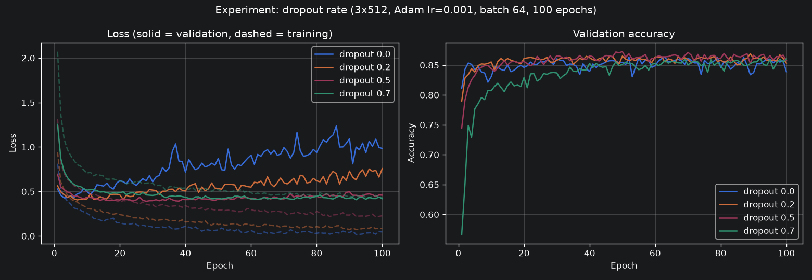
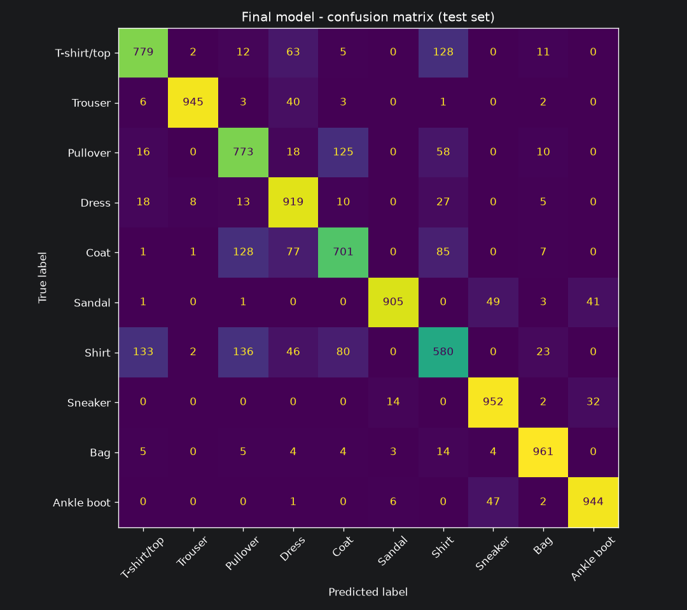

# Diagnosing training problems in a neural network (Fashion-MNIST)

A small experiment on what goes wrong when you train a neural network and how to fix it.
I trained a simple MLP on Fashion-MNIST, broke it on purpose in three ways
(overfitting, unstable training, underfitting), then fixed each problem
and checked with plots and numbers that the fix actually worked.

Made as a course project for Deep Learning in Python at PJATK.

## Setup

- **Data:** Fashion-MNIST (10 clothing classes, 28×28 grayscale images).
  I used only 5,000 images for training and 5,000 for validation, on purpose,
  so overfitting is easy to see. The official 10,000-image test set is used once, at the end.
- **Model:** an MLP built with Keras (Dense + ReLU layers, softmax output).
- **Baselines:** "always guess one class" (~10% accuracy) and a small MLP (784 → 128 → 10).

## What I did

| Problem | How I caused it | How I fixed it |
|---|---|---|
| Overfitting | big model (3 × 512) trained for 100 epochs | dropout + early stopping |
| Unstable training | learning rate too high (0.05) | lower learning rate / ReduceLROnPlateau |
| Underfitting | only 2 neurons, or learning rate 0.00001 | enough neurons, normal learning rate |

The main experiment varies **one factor, the dropout rate** (0.0 / 0.2 / 0.5 / 0.7),
with everything else fixed:

| Dropout | Best validation loss |
|---|---|
| 0.0 | 0.479 (then rises to 1.09) |
| 0.2 | 0.479 |
| **0.5** | **0.449** |
| 0.7 | 0.494 (learns too slowly) |



## Final model and results

3 × 512 MLP, dropout 0.5, Adam (lr 0.001), batch size 64, early stopping (patience 10).

| Model (test set) | Accuracy | Macro F1 |
|---|---|---|
| Always guess one class | ~0.10 | ~0.02 |
| Baseline MLP | 0.819 | 0.823 |
| **Final model** | **0.837** | **0.830** |

The gap between training and validation accuracy went from about 15 points
(big model, no dropout) to 4.4 points.



The hardest class is **Shirt** (recall 0.375). It mostly gets confused with T-shirt, Coat and Pullover.
That makes sense: an MLP sees pixels one by one and can't pick up small details like collars or buttons.
A CNN or more training data would be the natural next step.

## What I learned

- The loss curve shows overfitting earlier than accuracy does: the model gets overconfident before it gets less accurate.
- Overfitting: training loss goes down while validation loss goes up. Underfitting: both stay high.
  Unstable training: even the training loss jumps around.
- Change one thing at a time, keep the seed fixed, and choose by validation. Look at the test set only once.

## How to run

```
pip install -r requirements.txt
```
Then open `project.ipynb` and run all cells. The dataset downloads automatically.
All plots are saved in `results/`.